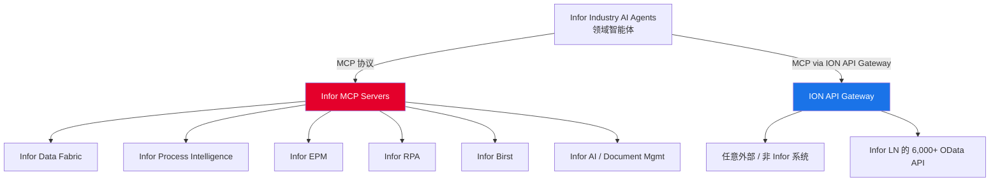
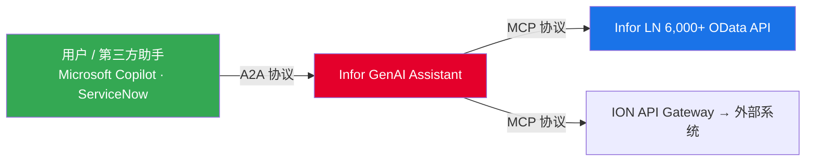
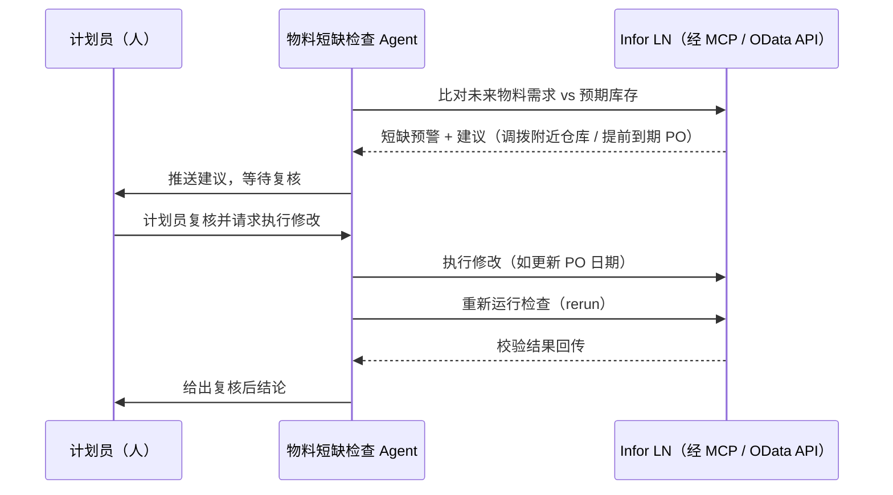

# Infor LN 的 AI 智能体架构：MCP 暴露 6,000+ OData API，100+ 智能体收敛为 12 个领域智能体

> 2026 年 10 月发布的 CloudSuite 2026.10 与同期 Velocity Week 2026，把 Infor 的 AI 叙事从「单点 AI」推向「可编排、可治理的多智能体生产化部署」。其中与 Infor LN 关系最紧密的两个数字——**经 MCP 暴露 6,000+ OData API**、**100+ 单体智能体收敛为 12 个 domain agents**——最能说明 Infor 的智能化门槛与架构取向。本页做完整拆解。

---

## 🎯 一句话结论

Infor 没有去「造更多小智能体」，而是把底层 **LN 6,000+ 业务 API 通过 MCP（Model Context Protocol）标准化暴露**，再把上层 **100+ 个一次性用途（single-purpose）智能体收敛为 12 个按业务领域划分的 domain agents**。既能让智能体直接调 LN 的业务能力（无需硬编码集成），又让访问控制仍由 ERP 既有的 API 授权与安全策略兜底——**「能干活」取决于底层有没有结构化、可调用、带权限的业务能力；「好运维」则来自从一堆小 agent 回归少数领域 agent 的架构收敛**。

---

## 🔢 两个关键数字（先讲清楚）

这两个数字来自 Infor 2026.10 发布中与汽车 / 分销产品线相关的官方口径，经 [ERP Today](https://erp.today/infor-builds-ai-agents-into-automotive-distribution-and-cpq-software/) 与 [Infor 官方汽车博客](https://www.infor.com/en-au/blog/cloudsuite-automotive-2026-10-automation-agentic-enterprise/) 逐项梳理，并被中文行业媒体 [zodioo](https://www.zodioo.com/zh_TW/blog/industry-news-6/erx-agentic-erp-gartner-infor-1108-965) 归纳为「比『多少个 Agent』更能说明门槛」的两项指标。

| 数字 | 含义 | 口径来源 |
|------|------|----------|
| **6,000+** | Infor LN 经 MCP 暴露的 **OData API** 数量（2026.10，厂商技术文件口径） | Infor 2026.10 说明 / ERP Today |
| **100+ → 12** | 单一用途智能体（single-purpose agents）**收敛为领域智能体（domain agents）** 的数量变化 | Infor 2026.10 说明 / ERP Today |

> ⚠️ 口径提示：这两个数字是「能力底座 + 架构取向」的说明性指标，并非「12 个 agent 已 GA 且全部可用」的承诺。Infor 自有 MCP servers 自 2026 年 4 月起处于 **limited availability**，官方 4 月公告并未点名覆盖 LN 或 M3（详见 [技术深潜](#tech-dive) 一节）。

---

## 🧭 背景：Velocity Suite 与 Agentic Orchestrator

要充分理解这两个数字，需要先看它们所处的平台层。Infor 的 AI 能力自 2026.04 起统一归入 **Infor Velocity Suite**（与每个 CloudSuite 搭配的 AI 加速器），核心组件是 **Infor Agentic Orchestrator** 与 **Infor Industry AI Agents**（即原 Coleman AI 能力的演进，全站统一写作「Infor AI（原 Coleman AI）」）。

- **Infor Agentic Orchestrator**：Velocity Suite 内的「协调引擎」，以 supervisor-led（监督者主导）方式跨流程编排多个任务智能体，保持上下文与治理；运行于 **AWS Bedrock** 托管基础模型环境，借助 **Bedrock Guardrails** 实现内容治理与区域化推理。
- **Infor Industry AI Agents**：面向行业的角色化智能体，基于行业云套件、行业流程目录与领域语言模型（而非通用横向模型）。
- **Infor IQ**：语义层，为所有智能体提供一致的「业务理解」，开箱即用 **350+ 预置用例**。
- **GenAI Knowledge Hub / GenAI Assistant / Agent Factory / Process Mining / Value+**：构成「诊断 → 治理化执行」闭环的其余组件。

> 完整组件表与关系图见 [Infor OS / Velocity Suite](../by-product/infor-os.md)；版本演进与逐项能力清单见 [版本动态](../resources/release-notes.md)。

---

## 🔌 MCP：智能体如何接入 LN 业务系统

### 什么是 MCP

**MCP（Model Context Protocol，模型上下文协议）** 是由 Anthropic 于 2024 年底提出、2025 年 12 月捐给 Linux 基金会 Agentic AI Foundation（AAIF）的开放标准。它解决的核心问题只有一个：**让 AI 智能体以统一、结构化、可审计的方式调用「工具和数据」**，而不必为每个系统写一套定制集成。业界常把它概括为「AI 世界的 USB-C」。

### Infor 的 MCP 实现

Infor 自 2026.04（Agentic Orchestrator 增强版，limited availability）起引入原生 **MCP server 集成**。其架构有两层含义：

- **原生 MCP server**：直接把 Infor 自家应用（Data Fabric、Process Intelligence、EPM、RPA、Birst、AI、Document Management）暴露为 MCP 工具，智能体在 GenAI Assistant 中即可「引用并执行」这些 MCP 工具，无需定制实现。
- **ION API Gateway 的 MCP 连接器**：把**任意外部 API 转换为可用的 MCP server**。这是 Infor 把 MCP 延伸到非 Infor 系统的关键——也是 LN 6,000+ OData API 能被智能体标准化的入口。

> 正如 Infor 在 [Agentic Orchestrator 官方博客](https://www.infor.com/en-au/blog/infor-agentic-orchestrator-ai-value-drivers) 所述，MCP 把企业 AI 项目里通常消耗 **30%–40% 预算**的集成开销大幅降低。

### LN 的 6,000+ OData API 经 MCP 暴露

在汽车与分销套件中，Infor 明确给出 MCP 的工程价值：

- **对 LN**：基于 Infor LN 的 CloudSuite 方案，让 agent 以「标准方式」触达业务流程与 LN **6,000+ 个 API**，而**无需硬编码集成**（hard-coded integrations）。
- **对分销**：MCP 提供**单一受治理接口（single governed interface）**，取代此前「每个 agent 各做一套集成」的重复劳动。

这意味着：过去要接 LN 的某个业务动作，开发团队得为每个 agent 单独写连接器；现在只要 LN 的 OData API 被 MCP 暴露，任何符合 MCP 规范的智能体都能「发现并调用」，且复用同一套治理。

### 关键安全前提：既有授权策略继续生效

无论是 MCP 还是 A2A，Infor 反复强调同一句话：**既有的 API 授权与安全策略继续管理访问（existing API authorizations and security policies continue to govern access）**。在汽车场景中，「访问控制权仍留在 ERP 手中（access control stays with the ERP）」——一个 agent 能触达什么，由 LN 既有的 API 权限决定，而非由 agent 自己决定。

---

## 🤖 12 个领域智能体：从 100+ 单体智能体收敛

### 为什么收敛

Infor 的 Industry AI Agent 库在 2026.04 已扩展到 **100+ 个行业专属智能体**（按微垂直 / 角色 / 流程覆盖）。但「一堆小 agent」带来的是**运维复杂度**：每个 agent 各自集成、各自治理、各自评测。汽车 / 分销的 2026.10 公告把 LN 侧的智能体**收敛为 12 个 domain agents**——这是「运维复杂度逼出的架构回归」。

### 12 个领域对应 LN 的 12 个角色域

据 [版本动态](../resources/release-notes.md) 中 Infor 2026.10 披露的 LN 角色智能体矩阵，这 12 个 domain agents 覆盖：

| # | Domain Agent（领域） | 对应 LN 业务域 |
|---|----------------------|----------------|
| 1 | **Manufacturing**（制造） | 生产订单、产能、车间控制 |
| 2 | **Supply Chain**（供应链） | 供需匹配、计划 |
| 3 | **CRM** | 商机、客户 360 |
| 4 | **Procurement**（采购） | 采购订单、供应商异常 |
| 5 | **Logistics**（物流） | 出库、运输、发运 |
| 6 | **Service**（服务） | 售后、现场服务 |
| 7 | **Financials**（财务） | GL / AP / AR / 期间关账 |
| 8 | **Sales Order**（销售订单） | 报价→订单→交付 |
| 9 | **Engineering**（工程） | 设计变更、BOM 影响 |
| 10 | **Quality Inspection**（质量检验） | 不合格品、SPC、NCR |
| 11 | **Project**（项目） | 项目绩效、风险、成本 |
| 12 | **Common Master Data**（通用主数据） | 物料 / 客户 / 供应商主数据 |

> 注意区分两个「100+」：**Industry AI Agent 库整体有 100+ 个**（跨行业、跨产品的角色智能体）；而 **LN 这一产品线把 100+ 个单用途智能体收敛为 12 个 domain agents**。前者是「库规模」，后者是「LN 侧的架构归并」。详见 [技术深潜](#tech-dive) 一节对 MCP server limited availability 现实的拆解。

### 分销线的 7 类业务智能体（对照）

在 CloudSuites for Distribution 中，Infor 列出了更细的 7 类业务 agent，可视为 domain agents 在分销场景的落地实例：

`库存 Inventory` · `产品 Product` · `报价 Quoting` · `财务 Finance` · `采购 Procurement` · `供应链 Supply Chain` · `定价 Pricing`

它们监控需求、供给与交易，并在报价、采购、订单录入、会计之间协调工作；WMS 中另有 **Batch Wave Agent**（按需把共享行项的订单合成拣货波次）与 **User & Task Management Agent**（用自然语言办理入职、权限与任务改派）。

---

## 🔗 A2A 协议：智能体之间的互联

### 什么是 A2A

**A2A（Agent2Agent Protocol）** 由 Google 于 2025 年 4 月开源，2025 年 6 月捐给 Linux 基金会，2026 年 8 月并入 AAIF（与 MCP 同处一个中立治理机构）。创始治理成员包括 **AWS、Cisco、Google、Microsoft、Salesforce、SAP、ServiceNow**；v1.0 于 2026-03-10 发布。技术栈刻意「无聊」：HTTP + JSON-RPC 2.0 + Server-Sent Events，用 **Agent Card**（JSON 元数据）做能力发现。

### Infor 怎么用 A2A

Infor 在分销套件中明确：**Agent2Agent（A2A）协议支持把 Infor GenAI Assistant 连接到第三方助手，如 Microsoft Copilot 与 ServiceNow**。其价值在于——让 Infor 的智能体更靠近终端用户已在用的应用，减少跨生态的协调与集成摩擦。

### MCP vs A2A：两个正交的轴

业界对两者的经典定位（见 [perform.digital](https://perform.digital/blogs/agent2agent-internet-of-agents)、[inferenceloops.com](https://inferenceloops.com/en/blog/a2a-and-the-agent-internet)）：

| 维度 | MCP | A2A |
|------|-----|-----|
| 方向 | **垂直**：agent → 工具 / 数据 | **水平**：agent → agent（对端为 peers） |
| 解决什么 | 智能体如何「使用工具」 | 智能体如何「与同事协作」 |
| 典型场景 | LN MCP server 暴露 OData API 给本agent | Infor GenAI Assistant 把任务委托给 Copilot / ServiceNow |
| 治理 | 经 ION API Gateway / 既有 API 权限 | Agent Card 声明能力与鉴权，不暴露内部提示与模型 |

> 一句话：**MCP 是 agent 怎么用工具，A2A 是 agent 怎么跟同行打交道**。一个跨组织的采购流程可能同时用到两者——规划 agent 经 A2A 把子任务委托给专门的风险评估 agent，后者再经 MCP 调自己的 CRM / 数据源。

---

## 🛡️ 治理与安全（Governed by default）

Infor 把「治理、风险与合规内建到核心」作为 Velocity Suite 的差异化卖点。落到 LN 智能体架构上，有几个关键机制：

- **既有 API 授权与安全策略继续生效**：agent 能触达什么，由 LN / ION 既有的权限决定（access control stays with the ERP）。
- **Supervisor Agent（监督者智能体）**：在敏感操作执行前**要求用户确认**，并在多步工具调用间保持上下文、逐步校验执行。
- **Inline Thoughts**：实时展示智能体的推理路径，提升可解释性。
- **Evaluation Framework**：把 agent 行为对照期望结果做自动评估校验。
- **Focus Mode**：提升响应准确性与速度。
- **AWS Bedrock Guardrails**：为内容治理与双向护栏、区域化推理提供底层支撑（满足数据驻留要求）。
- **人机协同「人在环」**：以汽车缺料检查为例，官方原话是 **「Planners stay in control（计划员始终掌控）」**——agent 给建议，人复核，再让 agent 执行并重新校验。

---

## 🚗 端到端例子：汽车行业的「物料短缺检查」智能体

最能说明这套架构的，是 CloudSuite Automotive 2026.10 的物料短缺检查 agent（来自 [Infor 官方汽车博客](https://www.infor.com/en-au/blog/cloudsuite-automotive-2026-10-automation-agentic-enterprise) 与 [ERP Today](https://erp.today/infor-builds-ai-agents-into-automotive-distribution-and-cpq-software/) 拆解）：

流程要点：

1. **诊断**：agent 把即将到来的物料需求与预期库存比对，识别缺口。
2. **建议**：给出修复方案（如同集团附近仓库调拨、更新到期前采购单）。
3. **复核**：**计划员 review 建议**（Planners stay in control），而非 agent 自作主张。
4. **执行 + 重跑**：计划员请求变更后，agent 修改并重新运行检查校验。
5. **质量联动**：同属 Velocity Suite 的行业 AI 方案，把生产测量中的质量趋势（SPC）以图表 + AI 摘要直接带入 Infor LN。

> 这个例子正是「12 个 domain agents」中 **Supply Chain / Procurement / Quality Inspection** 三者的协同缩影，而非一个孤立的「缺料小工具」。

---

## 🔬 技术深潜：智能体如何真正接入 LN { #tech-dive }

来自集成商 [Pexon](https://pexon.com/connectors/infor) 的实践拆解（2026-09-19 核实），把「MCP 暴露 6,000+ API」这件事的工程现实讲清楚了：

### 接口选择：读与写分治

| 接口 | 在 LN 中的角色 | 适用 |
|------|----------------|------|
| **LN OData REST** | 读路径（read path）。在 Infor OS Portal 的 API Gateway 下可浏览，是大多数「状态类」读取工具的自然后端（生产订单 / 采购订单 / 仓储状态） | 状态查询、报表 |
| **ION BOD** | 多数**写**路径的归属。BOD（OAGIS XML，Sync / Process 动词）是 Infor 系统间交换变更的标准；LN 的写操作往往需要一个 BOD，由 Infor 自有逻辑落地 | 创建 / 更新业务对象 |
| **M3 MI 程序 + Data Lake** | M3 侧：数千个 MI 交易（如 `CRS610MI/GetBasicData`），字段名极简（`CUNO`、`ITNO`）；Data Lake 做近实时分析读取，从不作为写路径 | M3 专用 |

> Pexon 的关键提醒：Infor 自有 MCP servers 自 2026 年 4 月起 limited availability，**公告并未点名 LN 或 M3**；在 Infor 文档化覆盖的产品与版本之前，LN / M3 客户无法围绕它们规划 agent。因此「现在能落地的」往往是**基于已文档化接口、由团队自有的 MCP server**（后续可紧邻 Infor 自有 server 部署）。

### 上线前必须回答的 6 个问题

1. **为哪个公司 / 站点行动，谁决定？** LN 按公司（company）与站点（site）授权，ION API Gateway 再叠加自身权限。
2. **哪些操作必须写，每个是否都有对应 BOD？** 多数团队知道集成，却很少映射「agent 的写该用哪个 BOD 变体」。
3. **哪些定制改了工具会读到的表？** 往往只装在个一两人脑子里，没写下来给 agent 用。
4. **API Gateway 对新客户端的节流策略是什么？** 配额、限流、尖峰抑制默认可配，却很少为 agent 设置。
5. **非 Infor agent 使用 ION API 是否包含在订阅内？** 只有 Infor 能答。
6. **谁来把 CUNO、ITNO 等字段名翻译成人话？** 语义层（Infor IQ）要补的就是这一环。

---

## 🌐 行业观察：开放 vs 控制（Infor vs SAP）

行业媒体 [WorkAI.tv](https://workai.tv/?p=10060) 把这两个数字放到更大的竞争格局里解读：Infor 正把自己定位为 **SAP 日益「受控」AI 架构的开放替代**。

- **SAP 侧**：2026 年 4 月的政策要求第三方 agent 在「SAP 批准的架构内」运行，被批评把编排层控制权交到厂商而非客户手里。
- **Infor 侧**：以「让你的 agent 跟我们的 agent 对话（let your agents talk to ours）」为姿态，通过 **6,000 个已发布 API + 实时流入 Databricks / Snowflake 的数据湖**，让包括 Microsoft Copilot 在内的第三方 AI agent 直接与其 ERP 原生 agent 对话，**无需 SAP 式架构审批**。
- **本质**：ERP 掌握交易上下文（采购单、付款条款、供应商关系），agent 要「行动」而非「建议」就必须能触达它。厂商对 agent 访问该上下文的控制方式，决定了你所有自动化的天花板。MCP 与 A2A 正成为这一层的开放标准候选——Infor 在协议上的站位，比 API 数量本身更关键。

> 中立提示：上述为第三方媒体观点，带有立场。Infor 的「开放」与「锁定」共生在同一套架构里——若其预置 agent 已覆盖核心流程，在平台外自建的激励会下降。是否采用，请结合自身 AI 栈外置程度判断。

---

## ⚠️ 可用性口径与中立提示

据 [ERP Today](https://erp.today/infor-builds-ai-agents-into-automotive-distribution-and-cpq-software/) 与 [ERP News](https://erpnews.com/infor-details-ai-agents-for-distribution-erp-warehouse-picking-and-finance/) 的整理，2026.10 这批公告**未提供可测量的客户成效**，也**未附逐产品 entitlement / availability 矩阵**。启用步骤以 [Infor Community 发布页](https://community.infor.com/releases/october2026/distribution) 为准。规划升级前，请向厂商确认：版本、地区、许可档位与启用条件，以及 **MCP servers / A2A / domain agents 在你所在租户的实际可用状态**。

---

## 📖 术语对照表

| 术语 | 含义 |
|------|------|
| **MCP** | Model Context Protocol，连接 AI agent 与工具 / 数据的开放标准（垂直轴） |
| **A2A** | Agent2Agent Protocol，连接不同厂商 AI agent 的开放标准（水平轴） |
| **Domain Agent** | 按业务领域划分、管理某职能内一组任务的角色智能体（如 LN 的 12 个） |
| **Single-purpose Agent** | 只做一件一次性任务的原子智能体（100+ 收敛前形态） |
| **Supervisor Agent** | Agentic Orchestrator 中的监督者，跨步骤编排任务 agent 并要求敏感操作人工确认 |
| **OData API** | LN 基于 OData 的 REST 接口，MCP 暴露的主要读路径 |
| **ION BOD** | Infor 基于 OAGIS XML 的业务对象文档，多数写路径的归属 |
| **ION API Gateway** | Infor 的 API 网关，也是把任意外部 API 转为 MCP server 的入口 |
| **Velocity Suite** | Infor 的 AI 加速器，含 Industry AI Agents / Agentic Orchestrator / IQ 等 |
| **Agentic Orchestrator** | Velocity Suite 内的协调引擎（supervisor-led，运行于 AWS Bedrock） |

---

## 📚 来源清单

- [ERP Today — Infor Builds AI Agents Into Automotive, Distribution, and CPQ Software](https://erp.today/infor-builds-ai-agents-into-automotive-distribution-and-cpq-software/)（两个关键数字、MCP / A2A 口径、汽车 / 分销 / CPQ 细节）
- [Infor 官方博客 — CloudSuite Automotive 2026.10（自动化与 Agentic Enterprise）](https://www.infor.com/en-au/blog/cloudsuite-automotive-2026-10-automation-agentic-enterprise)（缺料检查 agent、6,000+ API、100+→12）
- [Infor 官方博客 — CloudSuites for Distribution AI（2026.10）](https://www.infor.com/en-nl/blog/infor-cloudsuites-distribution-ai-october-2026)（7 类业务 agent、MCP 单一受治理接口、A2A、100+ 新增 API）
- [Infor 官方博客 — Infor CPQ 2026.10（Embedded AI）](https://www.infor.com/en-au/blog/infor-cpq-2026-10-release-embedded-ai)（AI 建模 / 报价 / 文档驱动交易 agent）
- [Infor 官方博客 — Agentic Orchestrator: How coordinated AI agents become precise value drivers](https://www.infor.com/en-au/blog/infor-agentic-orchestrator-ai-value-drivers)（supervisor-led、原生 MCP、100+ 行业 agent、30–40% 集成开销）
- [Infor Velocity Suite 产品页](https://www.infor.com/platform/velocity-suite)（套件定位与组件）
- [zodioo — ERX / Agentic ERP 中文解读（2026-11-08）](https://www.zodioo.com/zh_TW/blog/industry-news-6/erx-agentic-erp-gartner-infor-1108-965)（两个数字的中文归纳）
- [WorkAI.tv — How open ERP APIs and data speed up agentic AI integration](https://workai.tv/?p=10060)（Infor vs SAP 开放 / 控制格局）
- [Pexon — Infor LN integration for AI agents: which interface reads, which one writes](https://pexon.com/connectors/infor)（读 / 写接口分治、MCP server limited availability 现实、6 个前置问题）
- [Infor Community — October 2026 Release（Distribution）](https://community.infor.com/releases/october2026/distribution)（启用步骤权威入口）
- [perform.digital / inferenceloops.com / luwai.fr / aiwiki.ai](https://perform.digital/blogs/agent2agent-internet-of-agents)（A2A 协议背景、MCP vs A2A 关系、Linux 基金会治理）

---

## 🔗 相关页面

- [Infor OS / Velocity Suite](../by-product/infor-os.md) — AI 组件完整清单与架构图
- [版本动态](../resources/release-notes.md) — 2026.10 能力矩阵与 11-04 官方博客细节
- [行业动态](../resources/news.md) — 2026 生态大事件时间线与分析师认可
- [Infor LN 产品页](../by-product/ln.md) — LN 技术架构、版本历史与 2026 要点
- [ION 集成解析](../ecosystem/ion-integration.md) — BOD 结构与集成场景

---

**最后更新**：2026-11-12
